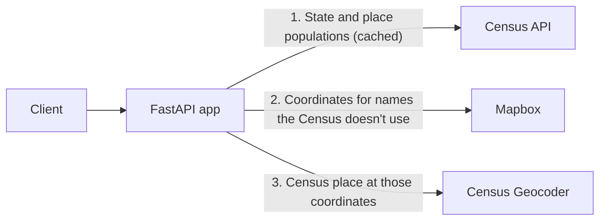

# Census Population API

[](https://github.com/datalogicpro/fastapi_census/actions/workflows/tests.yml)

A FastAPI app that returns population data for US states, cities, and towns from the US Census Bureau.

**Live demo:** https://fastapi-census.onrender.com/docs

The app runs on Render's free plan, so the first request after a quiet period can take up to a minute while it wakes up.

## Try It

```bash
curl https://fastapi-census.onrender.com/v1/population/Alaska
```

```json
{"state": "Alaska", "population": 735706}
```

## Features

* Population for any US state, plus the District of Columbia and Puerto Rico.
* Population for cities and towns, including small ones.
* Returns every place in the state with a matching name, since many share names.
* Finds names the Census doesn't use, such as neighborhoods and hyphenated town names, and returns the Census place that contains them.
* Uses the latest Census American Community Survey 5-year data (2024).
* Caches Census data in memory, so repeat lookups are fast.
* Async calls to outside APIs through one shared HTTP client, with retries and exponential backoff.
* JSON logs with a request ID on every line.
* Error tracking with Sentry in production.
* Rate limit of 60 requests per minute per client.
* Versioned routes under `/v1`.

## How It Works



1. The app gets the state's population and its list of places from the Census API, and caches them.
2. If no Census place has the name, the app asks Mapbox for the name's coordinates.
3. The app asks the Census Geocoder which Census place is at those coordinates, then returns that place's population from the cache.

Steps 2 and 3 run only when the name isn't a Census place.

## Tech Stack

* **Web:** Python 3.13, FastAPI, Pydantic, pydantic-settings, slowapi (rate limiting)
* **Outside APIs:** httpx (async), tenacity (retries with backoff)
* **Observability:** python-json-logger and asgi-correlation-id (JSON logs with request IDs), Sentry (error tracking)
* **Quality:** pytest, pytest-cov, httpx2 (test client), Ruff, mypy, pip-audit, pre-commit
* **Packaging:** uv (locked versions in `uv.lock`)
* **Deployment:** Docker, Render, GitHub Actions, Dependabot

## Project Structure

```text
fastapi_census/
├── main.py                   # Creates the app, adds middleware and routes, handles errors
├── config.py                 # Loads and checks settings and API keys
├── logging_config.py         # JSON logging with request IDs
├── monitoring.py             # Sentry error tracking
├── rate_limit.py             # Rate limiter shared by the routes
├── routes/
│   ├── health.py             # Health check endpoint
│   └── population.py         # Population endpoints
├── services/
│   ├── errors.py             # Error for bad data from outside services
│   ├── http_client.py        # Shared async HTTP client and retries
│   └── population.py         # Calls to the Census, Mapbox, and Census Geocoder
├── schemas/
│   └── population.py         # Pydantic response models
├── tests/
│   ├── conftest.py           # Shared test setup
│   ├── helpers.py            # Fake API responses and sample data
│   ├── test_census.py        # Census data tests
│   ├── test_geocoding.py     # Mapbox and Census Geocoder tests
│   ├── test_http_client.py   # HTTP client and retry tests
│   ├── test_logging.py       # Request ID and JSON log tests
│   ├── test_monitoring.py    # Sentry setup tests
│   └── test_routes.py        # Endpoint, error, and rate limit tests
├── .github/
│   ├── workflows/tests.yml   # GitHub Actions checks and Docker build
│   └── dependabot.yml        # Dependency updates
├── .pre-commit-config.yaml   # Checks run before every commit
├── .dockerignore             # Files kept out of the Docker image
├── Dockerfile
├── pyproject.toml            # Version, packages, and pytest, coverage, Ruff, and mypy settings
├── uv.lock                   # Exact package versions, made by uv
├── .env.example              # Names of the keys and optional settings
├── CHANGELOG.md
└── LICENSE
```

## Requirements

* Python 3.13 or newer
* uv: https://docs.astral.sh/uv/
* A free Census API key: https://api.census.gov/data/key_signup.html
* A Mapbox access token: https://account.mapbox.com/
* A Sentry project (optional, for production): https://sentry.io/

## Installation

```powershell
git clone https://github.com/datalogicpro/fastapi_census.git
cd fastapi_census
uv sync
uv run pre-commit install
```

`uv sync` creates the `.venv` folder and installs the exact versions in `uv.lock`, including the testing and code-check tools.

## Environment Variables

Copy `.env.example` to a new file named `.env` in the project folder, then add your keys:

```text
CENSUS_API_KEY=your_census_api_key
MAPBOX_TOKEN=your_mapbox_token
```

Do not commit your `.env` file. If a key is missing, the app stops at startup with an error naming it.

These are optional:

```text
SENTRY_DSN=your_sentry_dsn
ENVIRONMENT=production
LOG_LEVEL=INFO
```

* `SENTRY_DSN` turns on Sentry. Set it only in production (on Render), so local runs and tests never send errors to it.
* `ENVIRONMENT` accepts `development` (the default) or `production`.
* `LOG_LEVEL` accepts `DEBUG`, `INFO` (the default), `WARNING`, `ERROR`, or `CRITICAL`.

Any other value for `ENVIRONMENT` or `LOG_LEVEL` stops the app at startup with an error naming it.

## Running the App

```powershell
uv run fastapi dev main.py
```

Interactive docs: http://127.0.0.1:8000/docs

## Running with Docker

```powershell
docker build -t fastapi-census .
docker run --rm -p 8000:8000 --env-file .env fastapi-census
```

Interactive docs: http://localhost:8000/docs

The container runs as a non-root user and listens on the `PORT` environment variable (default `8000`).

## Deployment

The live app runs on Render as a Docker web service, built from the `Dockerfile`.

Render settings:

* **Runtime:** Docker
* **Health check path:** `/health`
* **Environment variables:** `CENSUS_API_KEY`, `MAPBOX_TOKEN`, `SENTRY_DSN`, and `ENVIRONMENT=production`

Render sets the `PORT` variable, and the container listens on it.

## Endpoints

### `GET /v1/population/{state}`

Example: `/v1/population/Alaska`

```json
{
    "state": "Alaska",
    "population": 735706
}
```

### `GET /v1/population/{state}/{city}`

Example: `/v1/population/Hawaii/Kailua`

```json
{
    "state": "Hawaii",
    "places": [
        {
            "place": "Kailua CDP (Hawaii County), Hawaii",
            "population": 21818
        },
        {
            "place": "Kailua CDP (Honolulu County), Hawaii",
            "population": 39640
        }
    ],
    "note": null
}
```

The city name must match a Census place name exactly (not case-sensitive). Hawaii has two places named Kailua, so both are returned.

Place names follow the Census, which adds a type such as `city` or `CDP` (census-designated place).

If no Census place has the name, the API looks up the name with Mapbox, finds which Census place contains it, and returns that place with a note.

Example: `/v1/population/Hawaii/Kailua-Kona`

```json
{
    "state": "Hawaii",
    "places": [
        {
            "place": "Kailua CDP (Hawaii County), Hawaii",
            "population": 21818
        }
    ],
    "note": "The Census has no place named Kailua-Kona. It lies within Kailua CDP (Hawaii County), Hawaii."
}
```

### `GET /health`

Returns `{"status": "ok"}` when the app is running. Hosting services call it to check that the app is up. It makes no outside API calls and is not rate limited.

## Errors

* `404` with `State not found` or `City not found` when there is no match.
* `422` when a state or city name is blank or too long (state: 2 to 50 characters, city: 1 to 100 characters).
* `429` with `Too many requests, try again later` when a client sends more than 60 requests in a minute.
* `502` with `External data service error` if the Census, Mapbox, or the Census Geocoder fails, doesn't answer within 10 seconds, or sends data in an unexpected shape.

Timeouts, connection errors, and the status codes `429`, `500`, `502`, `503`, and `504` from an outside service are tried up to 3 times, with a growing wait between tries. Other errors, such as a bad API key, are not retried.

## Logging

Every log line is JSON, with a timestamp, level, logger name, message, and request ID:

```json
{"level": "INFO", "logger": "main", "message": "Request handled", "request_id": "3f2b9c...", "method": "GET", "path": "/v1/population/Alaska", "status": 200, "duration_ms": 41.7, "timestamp": "2026-10-11T17:20:05.123+00:00"}
```

Each response has an `X-Request-ID` header with the same ID. A client can send its own `X-Request-ID` (a UUID4), and the API uses it.

API keys are never written to the logs or sent to Sentry.

## Running Tests and Checks

```powershell
uv run pytest
uv run ruff check .
uv run ruff format --check .
uv run mypy .
uv run pip-audit
```

Tests use fake API responses, so they need no internet or real keys. The test run fails if coverage drops below 90% or if any warning appears.

GitHub Actions runs all five and builds the Docker image on every push to `main` and every pull request.

pre-commit runs these before every commit:

* File checks: trailing spaces, file endings, YAML and TOML syntax, merge conflict markers, and large files
* The uv lock check, which stops a commit if `uv.lock` is out of date with `pyproject.toml`
* Ruff and mypy

## Challenges

### Census place names include a type

* **Problem:** The Census lists places such as `Anchorage municipality` or `Kailua CDP`, so a search for `Anchorage` found nothing.
* **Solution:** The API drops the type before matching, so users can search by the plain name.

### Common names the Census doesn't use

* **Problem:** Names like `Kailua-Kona` are not Census places, so lookups for them failed.
* **Solution:** The API finds the name's coordinates with Mapbox, then uses the Census Geocoder to find the Census place at those coordinates.

### Short outages at outside services

* **Problem:** A single failed call to the Census or Mapbox meant a failed request for the user.
* **Solution:** Retries with exponential backoff and random jitter recover from brief outages without flooding the service.

### API keys in logs and error reports

* **Problem:** The Census and Mapbox URLs contain API keys, and httpx error messages include those URLs.
* **Solution:** The app logs only the error type, turns off httpx's request logs, and keeps Sentry from recording request URLs or local variables. Tests check that no key appears in the logs.

### Bad data from outside services

* **Problem:** A changed or broken response from an outside API crashed the app.
* **Solution:** Every response is checked, and an unexpected shape returns a clean `502`.

### Rate limiting behind a proxy

* **Problem:** Render sends requests through a proxy, so every client looked like the same address and shared one limit.
* **Solution:** The Docker image trusts the forwarded client address, so each client is counted separately.

### Installs that differed between machines

* **Problem:** `requirements.txt` pinned only the main packages, so the packages under them could differ between a laptop, GitHub Actions, and Docker.
* **Solution:** uv locks every package to an exact version in `uv.lock`. GitHub Actions and the Docker image install with `--locked`, so they fail instead of drifting.

## Limitations

* Population numbers are ACS 5-year estimates, not exact counts.
* When a name is found through Mapbox, the population is for the whole Census place that contains it, not just the named area.
* Areas outside any Census place (such as rural land) return `404`.
* The cache and the rate limit counts are kept in memory, so they reset when the app restarts and are not shared between servers.
* Moving to a newer survey year means changing the Census URL and redeploying.

## Future Improvements

* Move the cache and rate limit counts to Redis, so they survive restarts and work across more than one server.
* Make the survey year a setting, so moving to newer Census data needs no code change.
* Add county and ZIP code lookups.

## Data Sources

* **US Census Bureau API**: American Community Survey 5-year estimates, table B01003 (total population).
* **Mapbox**: finds coordinates for names the Census doesn't list.
* **Census Geocoder**: finds which Census place contains those coordinates.

## Author

Bobby ([datalogicpro](https://github.com/datalogicpro))

## License

MIT. See [LICENSE](LICENSE).
